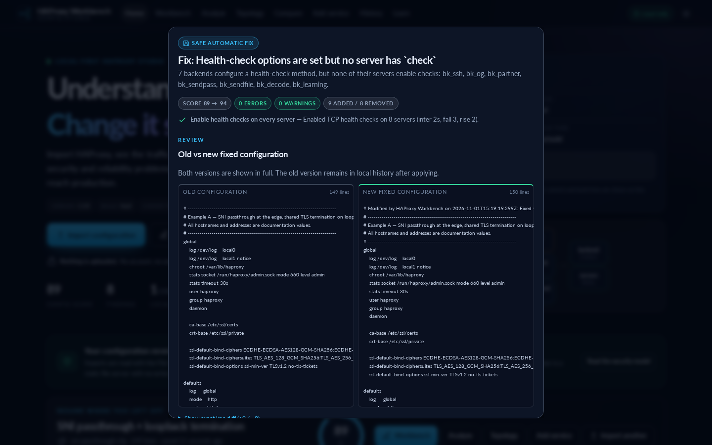
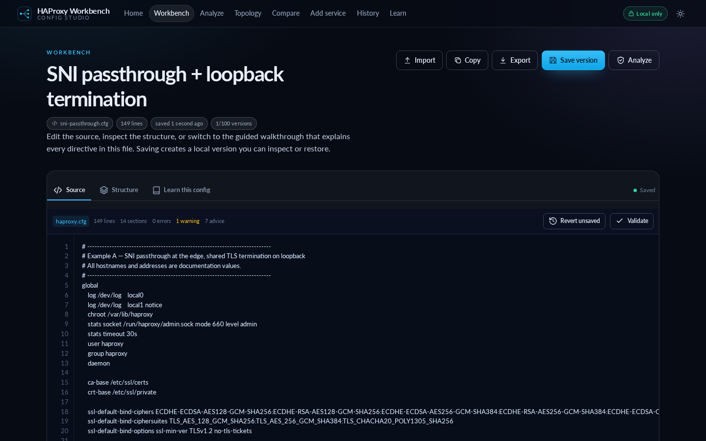
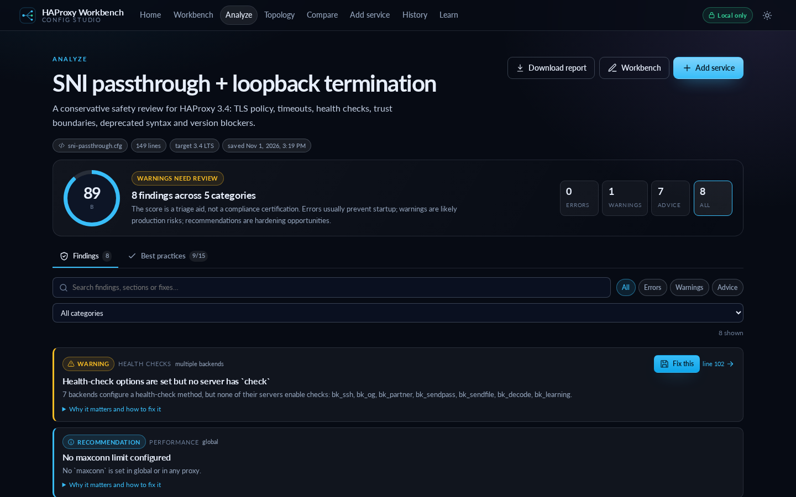
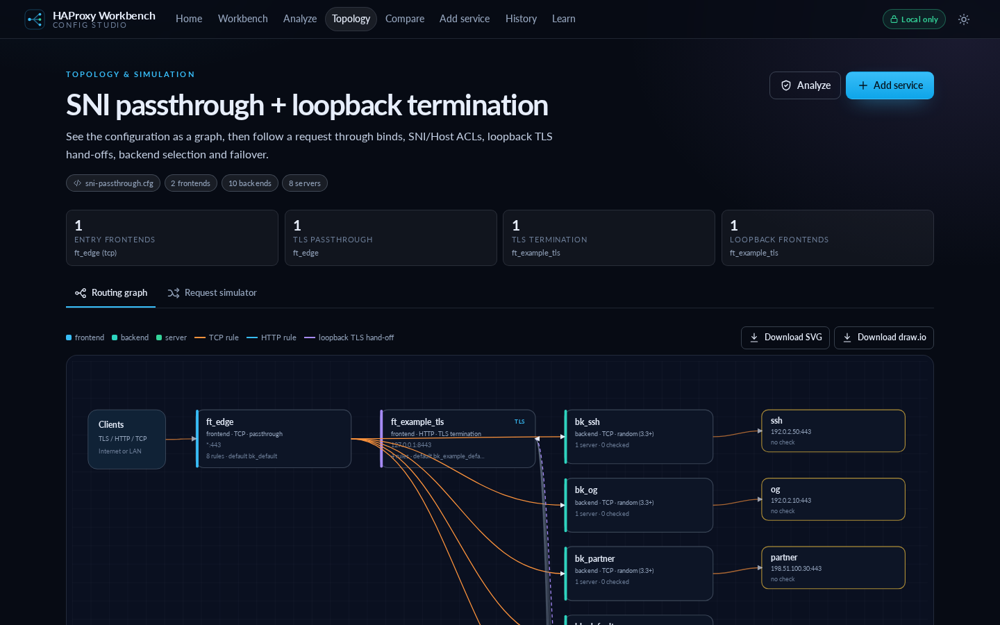
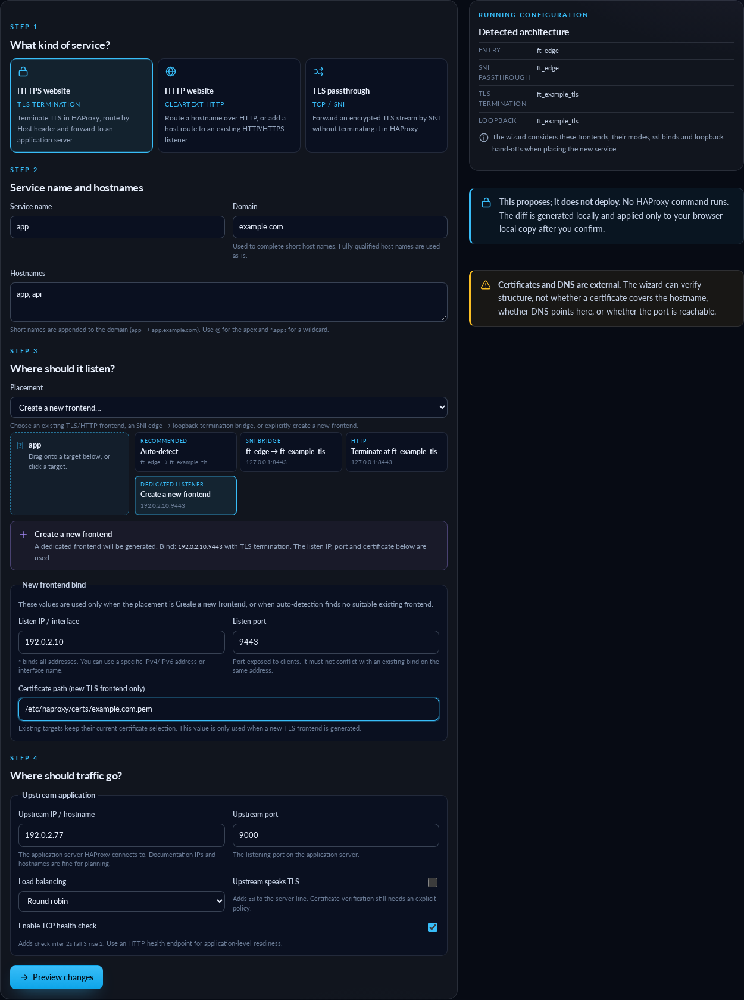
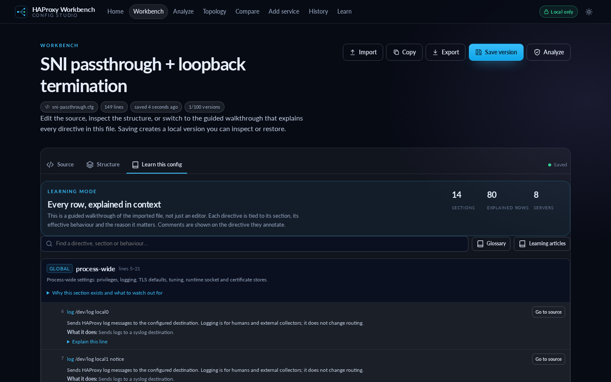
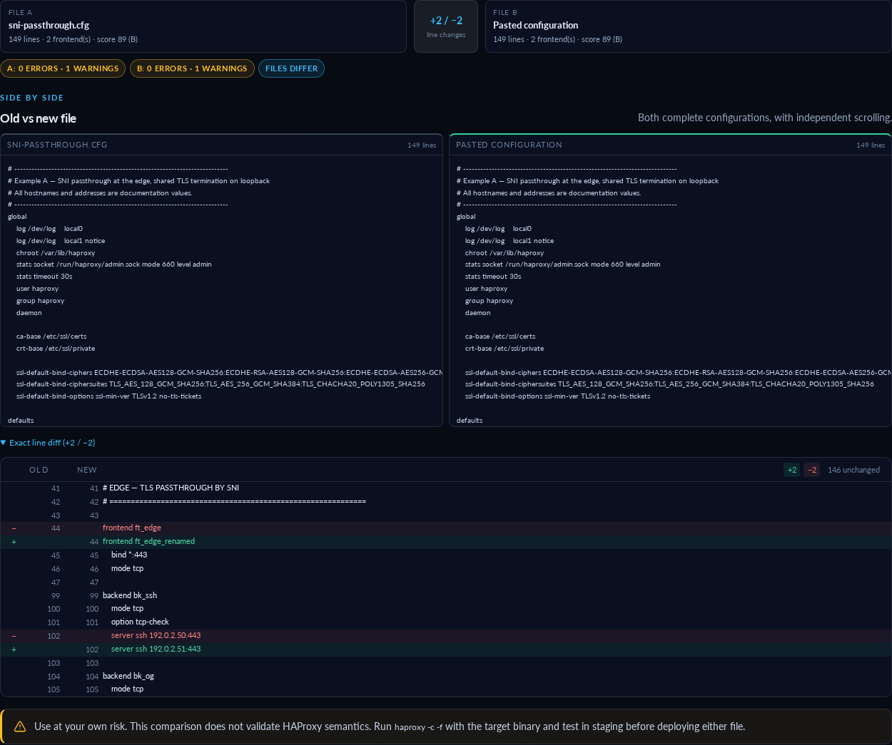
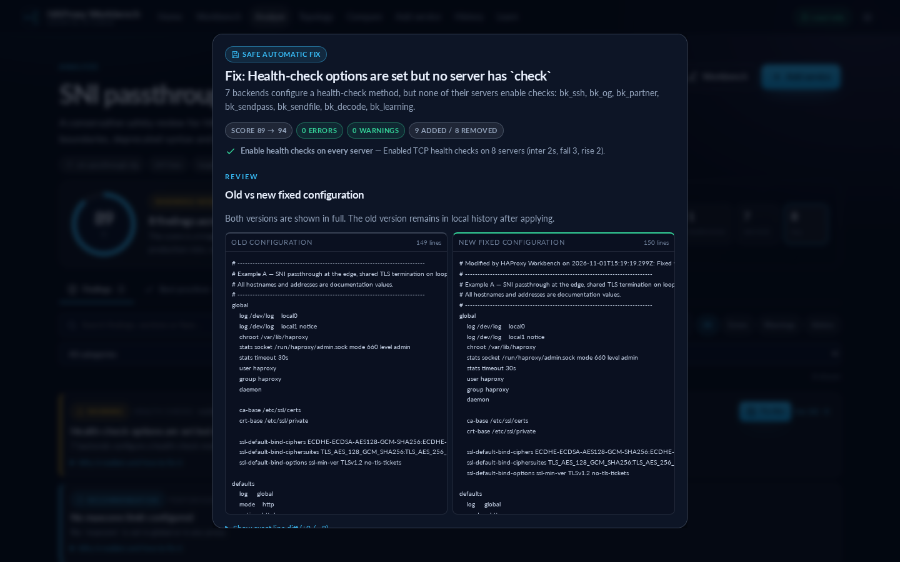
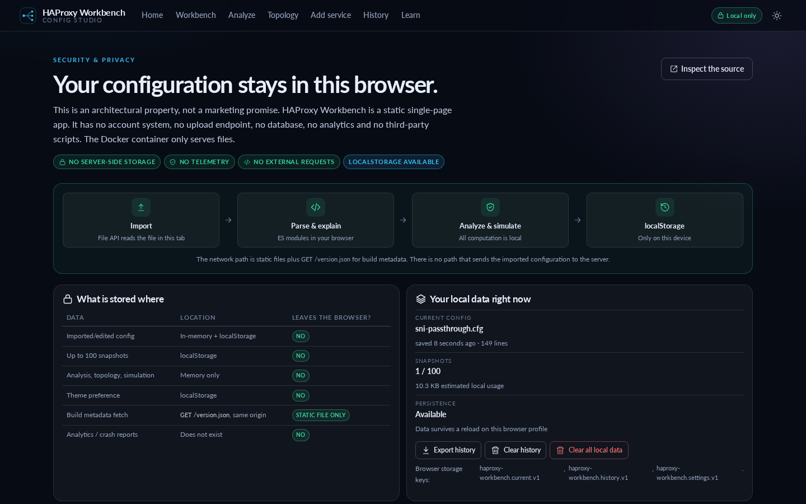

# HAProxy Workbench

[](https://github.com/RogerBergling/haproxy-gui/actions/workflows/ci.yml)

**A local-first HAProxy configuration studio: import, explain, analyze, visualize, simulate and safely change HAProxy configs — without uploading the configuration anywhere.**

[](https://github.com/RogerBergling/haproxy-gui/actions/workflows/docker-publish.yml)

```text
Import → parse → explain → analyze → visualize → simulate → add a service → export
                         ↕
                100-version local history
```

The published container is a static file server. All parsing, analysis, topology rendering, request simulation, service planning and version history happen in your browser. There is no account system, database, upload endpoint, analytics script or third-party request. The configuration never leaves the browser.

> **MIT licensed. Use at your own risk.** This is an independent tool, not official HAProxy software. Generated changes are annotated with the tool name, UTC date/time and action. Always review the old/new configuration and validate with `haproxy -c -f` against the exact production binary before deployment. No warranty is provided.

---

## Screenshots

| Home | Workbench |
|---|---|
|  |  |

| Analysis | Topology |
|---|---|
|  |  |

| Service wizard | Learning mode |
|---|---|
|  |  |

| Compare files | Warning fix with old/new config review |
|---|---|
|  |  |



All screenshots use the included anonymised example configurations.

---

## What it does

### Home page deployment stamp

The first page shows the application **version, build/image, commit, build time and a live browser clock**, both in the hero build line and in the build card. The footer repeats the same build stamp. Values are baked into `/version.json` by the Docker build; local runs gracefully show `dev`/`local`.

### Import, edit and export

- Import by file picker, drag-and-drop or paste. Files are read with the browser File API.
- A line-numbered source editor with live parse metrics.
- Export the current editor content as a `.cfg` file; copy it in one click.
- Structural parsing of `global`, `defaults`, `frontend`, `backend`, `listen`, `resolvers`, `peers`, `cache`, `ring`, `http-errors`, `mailers`, `program`, `fcgi-app`, `userlist`, `log-forward`, `crt-store`, `acme`, `traces` and other HAProxy sections.
- Unknown directives are preserved, never silently deleted. The tool does not pretend to be `haproxy -c`.

### Compare files

The dedicated **Compare** page loads two independent HAProxy files by picker, drag-and-drop or paste. It shows both complete configurations, the exact line diff, line counts, analyzer scores/error/warning counts and a clear changed/identical summary. Neither file is uploaded or saved to the server.

### Learn every row in your own config

- A **Learn this config** tab walks through every directive in the imported file, section by section. Each row shows its line number, the exact directive, what it does, its effective context, why it matters, syntax and links into the deeper guides.
- The Workbench **Structure** view remains available for quick technical inspection: section guides, effective modes, bind details and server/check state.
- A 10-article learning library covers the config mental model, TLS architectures, ACL/routing order, health checks and balancing, timeouts/logging, security, performance, operations, version upgrades and troubleshooting.
- A searchable **glossary** of 58 HAProxy terms with aliases and operator context.
- An **HAProxy versions** guide covering 2.6, 2.8, 3.0, 3.2, 3.3 and 3.4, including what changed, support/EOL context, breaking changes and a practical 2.x → 3.x upgrade checklist.
- The Learning page links directly to the row-by-row walkthrough for the currently loaded config.

### Analyze, warn and harden

The analyzer reports errors, warnings and recommendations across:

- Structure, references, duplicate names and duplicate binds
- Missing/unbounded timeouts and zero-timeout mistakes
- TLS minimum versions, ticket policy, weak ciphers and missing certificate sources
- Client-certificate trust, header injection and forwarded-scheme trust
- Health-check options that are inert because `check` is missing
- Logging, runtime socket permissions, `maxconn`, connection reuse and stick-table expiry
- HAProxy 3.x blockers: removed syntax, `program`/`mailers`, duplicate names, `enabled` dynamic servers, renamed OCSP tuning, deprecated directives

Each finding has a line number, explanation, why it matters and a concrete recommendation. The **Best practices** tab adds a pass/review/fail checklist plus opt-in, diff-previewed fixes for TLS baseline, missing timeouts, server health checks, Runtime API hardening and client-IP forwarding.

Findings that have a safe deterministic remediation expose a **Fix this** button directly. Clicking it shows:

- the full old configuration and the full new fixed configuration side by side
- the resolved fix summary
- score and error/warning deltas
- the exact line diff
- the risk to review before applying
- an apply step that creates a new local history version

The health-check warning in the examples — “Health-check options are set but no server has `check`” — is fixed directly by enabling `check inter 2s fall 3 rise 2` on the affected server lines. The old version remains available in History. Warnings that require an environment-specific decision (certificate paths, client CA bundles, logging destinations) still show manual guidance rather than making an unsafe change.

### See and simulate the routing graph

- An SVG topology of clients → entry frontends → loopback TLS hand-offs → backends → servers.
- Clickable nodes with bind, rule and server details.
- Exact routing conditions in a separate table.
- Download the graph as **SVG** or as an editable **draw.io / diagrams.net** file with named nodes, route labels, dashed TLS hand-offs and a generated timestamp/risk note.
- A request simulator for HTTPS, HTTP and TLS/TCP passthrough. It traces:
  - the selected entry frontend and bind
  - request-level `http-request` returns/denies
  - `use_backend` rules in order (pass/no-match)
  - default backend selection
  - server selection and backup behaviour
  - loopback TLS hand-off into an internal terminating frontend
  - 503, reset, refusal and tunnel outcomes
- Mark servers down and see the failure path. Unsupported ACL expressions are reported and treated as no-match rather than faked.

### Add a service with context

The guided wizard asks for the full network shape rather than hiding it:

1. **Service type** — HTTPS website with TLS termination, HTTP/www website, or TLS passthrough by SNI
2. **Service identity** — service name, **DNS domain**, and hostnames. Short names are combined with the domain (`app` → `app.example.com`); `@` means the apex and `*.apps` wildcards are supported.
3. **Where it listens** — auto-detected target, an explicit existing frontend/bridge, or **create a new frontend** with explicit listen IP/interface, listen port and certificate path. Drag the new-service card onto a target or click the target.
4. **Where traffic goes** — separate upstream IP/hostname and upstream port, upstream TLS, health check and balancing
5. **Review** — diff, resolved listen/upstream values, style/placement explanation, current-vs-proposed routing and an interactive simulator that runs requests against the complete proposed file

Generated edits follow the detected config design: indentation style, boxed or simple comments, new frontend after the last frontend, new backend after the last backend, and routes inserted before the first matching wildcard/rule or default backend. Each generated change is written back into the config with a replaceable marker containing **HAProxy Workbench, UTC date/time, action and a use-at-your-own-risk notice**.

It inspects the running configuration and can place a new HTTPS host behind an existing TCP/SNI edge and loopback TLS terminator, add a direct route to an existing TLS frontend, reuse an existing HTTP/HTTPS listener, or generate a completely new frontend and backend. It generates the backend and routing rule, then shows:

- a line-by-line diff
- score/error/warning impact
- current vs proposed request simulation
- certificate, DNS, port and health-check caveats
- an explicit apply step that creates a new local version

### 100-version local history

- Every import, manual save, service generation, best-practice apply and restore creates a local snapshot.
- Up to 100 versions, bounded by localStorage size.
- Compare **any two versions** — current vs snapshot or snapshot vs snapshot — with both complete configs and the exact line diff.
- Compare a version with the current config, download a snapshot, export all history as JSON, or restore in one click.
- Restores create a new snapshot, so a rollback can itself be inspected or undone.
- Clear history or all local data at any time.

---

## Privacy and security model

This is the important part. The design is intentionally serverless for configuration data.

```text
Browser tab
  File API ──► parser ──► analyzer ──► SVG ──► simulator ──► localStorage
                                                               │
                                                        100 snapshots
Server / container
  static files + GET /version.json only
```

- The container runs a Python stdlib static file server. It has no API, no database, no write path and no configuration storage.
- Imported configs are read by the browser and serialized into `localStorage` only.
- The only same-origin fetch is `/version.json`, used for version, image tag, commit and build date. If it fails, the app shows `dev`.
- No external fonts, CDNs, analytics, crash reporting or network calls.
- Strict CSP, `frame-ancestors 'none'`, `no-referrer`, `nosniff`, COOP/CORP and no-store caching.
- The Docker image runs as a non-root user, read-only, with all capabilities dropped and `no-new-privileges` in the included Compose file.
- User-controlled configuration text is escaped before rendering and is never evaluated as code.

### What it does **not** protect against

- Anyone with access to this browser profile/device can read `localStorage`, including configs, internal hostnames, IPs and history.
- A malicious browser extension or compromised device can read page data.
- Private keys, passwords or API tokens pasted into a config are exposed to the browser profile and any exported file. **Do not put secrets in a config.** Reference files with restricted permissions instead.
- The server operator can serve modified JavaScript. Use a trusted deployment or self-host from source.
- Exported configs and history JSON are plaintext infrastructure documents. Store them securely.

Read the full model in the app at **Security & privacy** (`#/security`) or in [the security page source](public/assets/js/pages/security.js).

**If you expose the container beyond localhost**, place it behind an HTTPS reverse proxy you trust and keep the image updated. The static host does not encrypt traffic between the browser and the server; the privacy property is about where the configuration is stored and processed, not about transport encryption. The default local launcher binds to `127.0.0.1`.

---

## Quick start

### Docker Compose (recommended for users)

The repository includes a ready-to-use [`compose.yaml`](compose.yaml) that pulls the published image, publishes port **8004**, uses a read-only root filesystem and drops capabilities.

```bash
curl -O https://raw.githubusercontent.com/RogerBergling/haproxy-gui/main/compose.yaml
docker compose up -d
```

Open **<http://localhost:8004>**.

Pull updates:

```bash
docker compose pull
docker compose up -d --force-recreate
curl -s http://localhost:8004/version.json | python3 -m json.tool
```

If the first pull fails with an authentication error, the GHCR package is still private. Make it public once in **GitHub → Packages → haproxy-gui → Package settings → Change visibility → Public**, or authenticate the host with `docker login ghcr.io`.

Build the image yourself:

```bash
docker build -t haproxy-workbench:local .
docker run --rm -p 8004:8080 --read-only --cap-drop=ALL \
  --security-opt=no-new-privileges:true haproxy-workbench:local
```

### Local, without Docker

Requires Python 3.10+ (stdlib only). No Node, build step or dependency install is needed at runtime.

```bash
python3 start.py
```

This picks the first free port in `8080–8099` and opens a browser. Use:

```bash
python3 start.py --port 8004 --host 127.0.0.1
python3 start.py --no-browser
```

Open the site through the server, not as a `file://` URL, because ES modules and same-origin fetches require HTTP.

### First run

1. Open **Home**.
2. Import a config, paste it, or open one of the two anonymised examples.
3. Inspect the **Workbench** source and structure.
4. Open **Analyze** for findings and best-practice fixes.
5. Open **Topology** to see the graph and simulate a request. Download it as SVG or draw.io.
6. Use **Add service**, including the domain, listen IP/port and drag-and-drop placement, to preview a new HTTPS/HTTP/SNI route and simulate the complete proposed file.
7. Use **Compare** to compare two independent files, or **History** to compare any two saved versions.
8. Export or download from **History** whenever you need a backup.

---

## Included examples

Both examples are fully anonymised: documentation TLDs (`example.com`, `example.net`) and TEST-NET IP ranges only.

- **Example A — SNI passthrough + loopback termination**: a TCP edge inspects SNI, routes SSH/wildcard/partner/example.com traffic, hands selected hosts to a loopback TLS frontend, and returns explicit 421/404 fallbacks. It deliberately includes health-check options without server `check` lines, so the analyzer has something useful to explain.
- **Example B — Edge TLS + client metadata + stick tables**: one HTTP/HTTPS frontend, conditional TLS metadata headers, client-certificate header handling without verification, cookie stickiness and `http-reuse never`. It deliberately includes a frontend without a bind and an unverified client-certificate path.

The parser, analyzer, simulator and service wizard are tested against both architectures.

---

## HAProxy versions

The app targets HAProxy 3.x guidance and includes branch notes for:

| Branch | Type | Status in this guide |
|---|---|---|
| 3.4 | LTS | Current LTS |
| 3.3 | Stable | Short support; removals landed here |
| 3.2 | LTS | Supported |
| 3.0 | LTS | Supported |
| 2.8 | LTS | Mature; migration baseline |
| 2.6 | LTS | Older; plan an upgrade |

The version guide covers `crt-store`, dynamic backends, OpenTelemetry, duplicate-name enforcement, the 3.3 default balance change (roundrobin → random), removed `program`/mailers sections, Runtime API behaviour, `enabled` dynamic servers, the `tune.ssl.ocsp-update` rename and more. It links to the authoritative HAProxy release notes and configuration manual.

Version data was reviewed **2026-11-01**. Always check the latest patch level and exact EOL statement at <https://www.haproxy.org/>.

---

## Important limits

- **Not a compiler.** The parser is structural and version-agnostic by design. Run `haproxy -c -f <file>` with the exact binary and branch that will serve traffic.
- **Not a deployment tool.** It does not SSH, reload, call the Runtime API or push to a server.
- **Simulation is a model.** It supports a documented ACL subset (Host/SNI/path/method/source/SSL state), assumes HTTP/1.1 semantics, does not resolve DNS or inspect certificates, and does not simulate health-check timers. Unsupported expressions are reported.
- **Certificate/DNS/network truth is external.** The wizard can validate structure, not whether a cert covers a hostname, DNS points to the proxy or a firewall allows a port.
- **History is local.** Clearing browser data deletes it. Export if it matters.
- **No secrets.** Do not paste private keys, passwords or tokens.

---

## Development

### Requirements

- Python 3.10+ for the static server and smoke tests
- Node.js 20+ for JavaScript syntax checks and unit tests
- Docker (optional) for image builds

### Commands

```bash
python3 scripts/verify.py       # repository, imports, docs, headers, packaging
python3 -m py_compile start.py scripts/verify.py scripts/smoke.py
python3 scripts/smoke.py        # starts the real server and checks HTTP behaviour
node scripts/check-js.mjs       # node --check every module
node --test                     # parser/analyzer/simulator/wizard/diff tests
```

The test suite covers:

- tokenisation, line continuations, CRLF/BOM, section ranges, binds, references and duplicate detection
- analyzer findings for TLS, timeouts, health checks, headers, duplicates and 3.x upgrade blockers
- SNI passthrough → loopback TLS termination → backend routing
- Host/SNI suffix safety, named/inline ACL conditions, failure and 503 paths
- service placement against both examples, including wildcard hosts, occupied ports and generated-config validation
- best-practice fixes, idempotency and checklist state
- line diff and edit-anchor behaviour

### Project layout

```text
public/
  index.html
  version.json                 # local placeholder; Docker build writes real metadata
  assets/css/app.css
  assets/js/
    app.js                     # hash router, theme, shell
    storage.js                 # localStorage current config + 100 snapshots
    version.js                 # /version.json loader and live clock
    ui.js                      # escaping, dialogs, diff renderer, toast, import
    config/
      parser.js                # structural HAProxy parser
      analyzer.js              # explainable findings and scoring
      simulate.js              # request/ACL/simulation engine
      wizard.js                # service placement, domain resolution and config proposal
      bestpractices.js         # opt-in fixes, per-warning fixes and checklist
      style.js                 # indentation/comment/section-order detection
      change.js                # dated change marker in generated configs
      diagram.js               # SVG topology
      drawio.js                # editable draw.io topology export
      diff.js                  # line diff
      edit.js                  # anchored text edits
    data/
      samples.js               # anonymised examples
      directives.js            # directive encyclopedia
      learn.js                 # long-form articles
      glossary.js              # 58 terms
      versions.js              # branch and upgrade guidance
    pages/                     # home, workbench, analyze, topology, compare,
                               # services, history, learn, versions, glossary, security
scripts/                       # verification and smoke tests
tests/                         # Node test runner suites
.github/workflows/             # CI + multi-arch GHCR publishing
```

### Build metadata

`Dockerfile` accepts `APP_VERSION`, `IMAGE_TAG`, `GIT_SHA` and `BUILD_DATE`, writes them to `public/version.json`, and labels the image. The home page shows version, image tag, commit, build time and a live browser clock; the footer repeats the build stamp.

### Publishing to GHCR

`.github/workflows/docker-publish.yml` publishes multi-arch (`linux/amd64`, `linux/arm64`) images to:

```text
ghcr.io/rogerbergling/haproxy-gui:latest
ghcr.io/rogerbergling/haproxy-gui:sha-<commit>
ghcr.io/rogerbergling/haproxy-gui:v<tag>        # when a tag is pushed
```

`main` pushes update `latest`; tags add version tags. Provenance and SBOM attestations are enabled. The first published package may need its visibility changed to Public in GitHub package settings.

---

## Security headers

The local Python server and the container send:

```text
Content-Security-Policy: default-src 'self'; script-src 'self'; style-src 'self' 'unsafe-inline';
  img-src 'self' data:; font-src 'self'; connect-src 'self'; object-src 'none';
  base-uri 'none'; frame-ancestors 'none'; form-action 'none'
Referrer-Policy: no-referrer
Permissions-Policy: camera=(), microphone=(), geolocation=(), payment=(), usb=()
X-Frame-Options: DENY
X-Content-Type-Options: nosniff
Cross-Origin-Opener-Policy: same-origin
Cross-Origin-Resource-Policy: same-origin
Cache-Control: no-store, no-cache, must-revalidate, max-age=0
```

The static handler supports `GET`/`HEAD`, blocks directory indexes and keeps resolved paths inside `public/`.

---

## License and risk

MIT licensed — see [LICENSE](LICENSE). **Use at your own risk.** Generated configurations and automated fixes are provided without warranty. Configurations are annotated with the tool name, UTC date/time and action when the app creates or modifies them. You remain responsible for review, validation with the target HAProxy binary, staging tests and production rollback.

HAProxy is a registered trademark of HAProxy Technologies. This project is unofficial and is not affiliated with or endorsed by HAProxy Technologies. The analyzer and guide complement, but never replace, the official configuration manual and `haproxy -c`.
